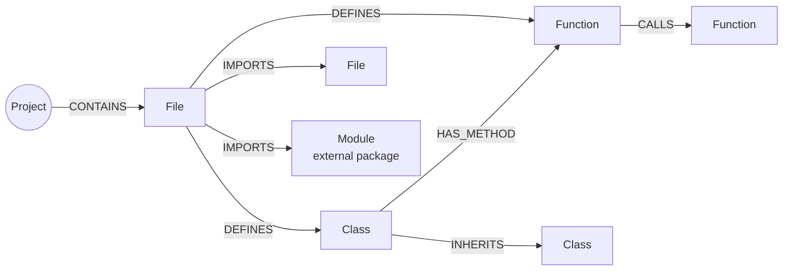
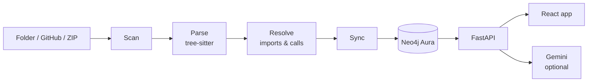

<div align="center">

# CodeAtlas

**Turn a code repository into a knowledge graph in Neo4j, then explore it, query it and ask it questions.**

[](https://codeatlas-1-awvc.onrender.com)
[](https://neo4j.com)
[](https://www.python.org)
[](https://fastapi.tiangolo.com)
[](https://react.dev)
[](https://tree-sitter.github.io)

[**Try the live demo →**](https://codeatlas-1-awvc.onrender.com) · [Deployment guide](CodeAtlas/docs/DEPLOYMENT.md) · [Supported languages](CodeAtlas/docs/LANGUAGES.md)

</div>

---

## About

CodeAtlas reads a repository, works out how its files, classes and functions depend on each other, and stores the result as a **property graph in Neo4j Aura**. Every view in the app is a Cypher query over that graph, so impact analysis, shortest paths, architecture layers and guided tours all come from the same source of truth.

Load a repository from a local folder, a public GitHub URL or a ZIP file. Then:

- see the **full dependency graph** and the **shortest path** between any two symbols;
- find out **what breaks** if you change a file or function;
- see the **inferred architecture** (layers, layering violations, dependency cycles, entry points);
- follow **guided tours** and get a **plain-language explanation** of any symbol;
- **search** the code by describing it, and ask **grounded questions** whose answers cite the graph.

> **GitHub "About" settings** (for the repository page): *Neo4j-powered code knowledge graph: parse repositories with tree-sitter, query dependencies, calls and architecture in Cypher, explore in a web UI.*
> Suggested topics: `neo4j`, `knowledge-graph`, `code-analysis`, `tree-sitter`, `static-analysis`, `fastapi`, `react`, `typescript`, `python`, `javascript`, `dependency-graph`, `code-graph`.

---

## Quick start

**Use the hosted app:** open **[codeatlas-1-awvc.onrender.com](https://codeatlas-1-awvc.onrender.com)**. Go to **Analyze repository**, choose a source, run a **dry run**, then confirm the write.

**Run it locally** (Python 3.11+, [uv](https://docs.astral.sh/uv/), Node.js 22+ and a Neo4j Aura instance):

```bash
git clone <this repository> && cd Neo4j
cp CodeAtlas/.env.example .env       # then fill in NEO4J_URI, NEO4J_USERNAME, NEO4J_PASSWORD, NEO4J_DATABASE

cd CodeAtlas
uv sync --frozen                     # backend dependencies
(cd ui && npm ci)                    # frontend dependencies

uvicorn codeatlas.api.main:app --port 8000    # terminal 1: API on http://127.0.0.1:8000
(cd ui && npm run dev)                        # terminal 2: web app on http://localhost:5173
```

Try it without a database first:

```bash
cd CodeAtlas
uv run python -m pytest                                              # offline test suite
uv run python -m codeatlas.cli analyze tests/fixtures/sample_repo --dry-run
```

---

## Features

### Load any repository

| Source | How | Notes |
|---|---|---|
| **Local folder** | Type a path | Read in place. Respects `.gitignore`, skips `node_modules`, `.venv`, `dist`, `build`, caches and minified bundles. |
| **GitHub URL** | `https://github.com/owner/repo`, optionally `/tree/<branch-or-tag>` | Public repositories. Downloaded as an archive, so `git` is not needed. |
| **ZIP upload** | Choose a `.zip` (up to 200 MB) | Extracted safely: path traversal, symlinks, zip bombs and encrypted entries are rejected. |

Every source goes through the same pipeline:

- **Dry run first.** See the project ID and the file, node and relationship counts without writing anything.
- **Confirm before writing.** Writes are scoped to one project, and updating an existing project needs a second confirmation.
- **Re-analyse any time.** The same GitHub URL and ref map to the same project and update it in place.

### Explore the graph

| Page | What it shows |
|---|---|
| **Overview** | Project counts and a complete-graph view that loads in pages. |
| **Graph** | Interactive files, classes and functions. Click a node for its properties and expand its neighbours. |
| **Paths & Impact** | The shortest path between two items. For a file or function: who imports it, who calls it, who inherits from it, and what static analysis cannot see. |

### Understand the architecture

| Page | What it shows |
|---|---|
| **Architecture** | Inferred layers (presentation, API, business, domain, data, infrastructure, utilities, tests), layering violations, dependency cycles and entry points. Unclear code stays *unclassified* instead of being guessed. |
| **Tours** | Guided walkthroughs built from the graph: project overview, entry point, component, execution path, dependencies and impact. Each step is marked *observed* or *inferred*. |
| **Explain** | For any function, class, file or module: signature, callers, callees, parent, likely side effects and unknowns. Optional AI interpretation, written only from those facts. |
| **Search** | Describe what you need in plain words. Results are ranked by name, path, docstring and graph signals, handle synonyms and typos, and show why each one matched. |

### Ask questions

Ask in plain English, such as *"What would break if I changed `models.py`?"* CodeAtlas runs a fixed Cypher query, retrieves a bounded set of facts from Neo4j, and asks the LLM to answer **only from those facts**. The facts and sub-graph are shown next to the answer. If the LLM is unavailable you get the evidence and a clear error, not an invented answer.

### Diagnostics

Neo4j and LLM status, graph integrity checks, and warnings about configuration problems.

---

## Languages

| Language | Extensions | Parser |
|---|---|---|
| Python | `.py` | tree-sitter-python |
| JavaScript | `.js`, `.jsx`, `.mjs`, `.cjs` | tree-sitter-javascript |
| TypeScript | `.ts`, `.mts`, `.cts`, `.tsx` | tree-sitter-typescript (TSX grammar for `.tsx`) |

Each language gets its own extractor and import resolver. Known limits are listed in [docs/LANGUAGES.md](CodeAtlas/docs/LANGUAGES.md). Other languages are not analysed yet; their files are ignored.

---

## What is in the graph



| Node | Meaning |
|---|---|
| `Project` | One analysed repository, with its source and languages |
| `File` | A source file, with its language, lines of code and hash |
| `Class` / `Function` | Classes, methods and functions, with line ranges and signatures |
| `Module` | An external package, such as `react` or `requests` |

Every relationship keeps its evidence. `IMPORTS` records the lines and imported names. `CALLS` records each call line and a **confidence**:

- `exact`: resolved with certainty (same file, imported name, `this`/`self` method, constructor).
- `name_match`: the only definition with that name in the project.

Calls that cannot be resolved honestly, such as `service.place()` on an unknown type, create **no edge**. They are listed on the function, so the graph never claims more than it knows.

**Why a graph database?** Code is a network. "What depends on this?" and "how does A reach B?" are traversals, which Cypher expresses directly. Every node carries a `project_id`, so many repositories share one database without mixing, and writes are stamped and swept, so a re-run converges to the current source. Open the same graph in the Aura console with the queries in [`CodeAtlas/cypher/aura_examples.cypher`](CodeAtlas/cypher/aura_examples.cypher).

---

## How it works



1. **Scan.** Find supported files (up to 1,500 per project). Files over 300 KB are skipped.
2. **Parse.** tree-sitter extracts symbols, imports and call sites.
3. **Resolve.** Each import and call is matched to its definition, with a confidence label.
4. **Sync.** Batched writes (500 rows per batch). A run locks the project, stamps its items with a run id, and sweeps stale items only if every batch succeeded. A failed run is flagged and shown as such.
5. **Serve.** FastAPI exposes the graph, the intelligence views and Q&A. The React app draws them. In production one service serves both.

No source code is sent to an LLM during analysis. The LLM is optional and only sees facts retrieved from the graph.

---

## Configuration

Settings come from environment variables, or from a `.env` file (`CODEATLAS_ENV_FILE`, then `CodeAtlas/.env`, then the repository root). Shell variables fill only values that the file does not define.

| Variable | Required | Purpose |
|---|---|---|
| `NEO4J_URI` | yes | `neo4j+s://<instance>.databases.neo4j.io` |
| `NEO4J_USERNAME` / `NEO4J_PASSWORD` | yes | Aura credentials (secret) |
| `NEO4J_DATABASE` | yes | Usually `neo4j` |
| `GEMINI_API_KEY` | no | Enables Q&A, tour narration and AI explanations (secret) |
| `GEMINI_MODEL` | no | Gemini model name |
| `GITHUB_TOKEN` | no | Raises GitHub's rate limit for GitHub URL imports. Read-only; sent only to `api.github.com`; never sent to the browser |
| `MAX_ARCHIVE_BYTES` | no | ZIP / download size limit (default 200 MB) |
| `MAX_EXTRACTED_BYTES` | no | Uncompressed size limit (default 600 MB) |

Secrets are used only by the backend. Nothing secret is included in the frontend bundle or in API responses.

---

## Deployment

CodeAtlas runs as **one web service**: the FastAPI backend serves the API and the built React UI on the same origin, so there is no CORS setup and no separate frontend host.

On Render (Python runtime):

| Setting | Value |
|---|---|
| Root directory | `CodeAtlas` |
| Build command | `pip install uv nodeenv && nodeenv -p -n 22 && cd ui && npm ci && npm run build && cd .. && uv sync --frozen` |
| Start command | `uv run uvicorn codeatlas.api.main:app --host 0.0.0.0 --port $PORT` |
| Health check | `/health` |

The live demo is deployed this way at **[codeatlas-1-awvc.onrender.com](https://codeatlas-1-awvc.onrender.com)**. The full step-by-step guide, with troubleshooting, is in [docs/DEPLOYMENT.md](CodeAtlas/docs/DEPLOYMENT.md).

---

## Limits

- **Languages:** Python, JavaScript and TypeScript for now. See [docs/LANGUAGES.md](CodeAtlas/docs/LANGUAGES.md) for each language's gaps.
- **Static analysis only:** no runtime traces, reflection, or computed dynamic imports. No type inference for calls on unknown receivers.
- **Repositories:** GitHub import works for public repositories only. Anonymous GitHub access is limited to 60 requests per hour; use a ZIP upload or set `GITHUB_TOKEN`.
- **Graph size per project:** 1,500 files, 25,000 nodes and 60,000 relationships. These limits fit AuraDB Free.
- **Hosting:** free-tier hosts sleep when idle, so the first request after a pause can take about a minute. Aura Free pauses after 72 hours of inactivity; resume it in the Aura console.
- **Search** is lexical plus graph-based, not embedding-based. **Architecture layers** are heuristic.

---

## Documentation

| Document | Topic |
|---|---|
| [Deployment](CodeAtlas/docs/DEPLOYMENT.md) | Render setup, environment variables, updates and troubleshooting |
| [Run & verify](CodeAtlas/docs/RUN_AND_VERIFY.md) | Local run guide and checking the graph in the Aura console |
| [Supported languages](CodeAtlas/docs/LANGUAGES.md) | What each language extracts, its limits, and how to add one |
| [Repository sources](CodeAtlas/docs/REPOSITORY_SOURCES.md) | Folder, GitHub and ZIP inputs and their safety checks |
| [Architecture intelligence](CodeAtlas/docs/ARCHITECTURE_INTELLIGENCE.md) | How layers, tours, explanations and search are computed |
| [Diagnostics](CodeAtlas/docs/DIAGNOSTICS_AND_FULL_GRAPH.md) | LLM errors, the complete-graph view and status reporting |
| [Example Cypher](CodeAtlas/cypher/aura_examples.cypher) | Queries to run in the Aura console |
