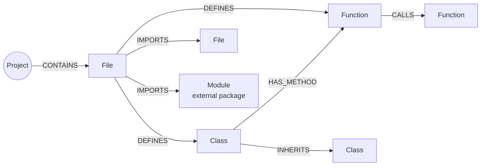
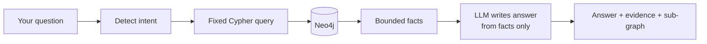
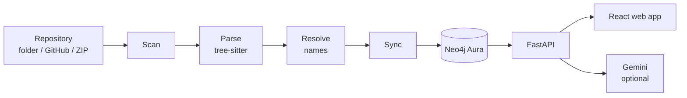

<div align="center">

# 🗺️ CodeAtlas

### Turn any repository into a living knowledge graph in Neo4j

Explore it visually. Ask it questions. Take guided tours. See how it is layered.


</div>

---

## What is CodeAtlas?

Joining a new codebase is slow. You open files, follow imports and grep for callers, and you still can't see the whole picture.

**CodeAtlas reads a repository, works out how everything connects, and stores it as a graph in [Neo4j](https://neo4j.com).** Files, classes and functions become **nodes**. Imports, calls and inheritance become **relationships**. Questions that take hours by hand become short graph queries:

- *"What breaks if I change `models.py`?"*
- *"How does `main()` reach the database code?"*
- *"Which parts of this project are the most depended on?"*

---

## 🔷 Neo4j is the heart of the project

Every feature below reads from the graph in Neo4j. Nothing is computed from a separate copy of the code.

| What CodeAtlas needs | How Neo4j delivers it |
|---|---|
| Store code as it really is: connected | **Nodes** for files, classes, functions and modules. **Relationships** for `IMPORTS`, `CALLS`, `INHERITS`, `DEFINES`. |
| "What depends on this?" | A short **Cypher** traversal, up to 3 hops. No joins. |
| "Shortest dependency path from A to B" | Native `shortestPath` over `IMPORTS` and `CALLS`. |
| Many repositories in one database | Every node carries a `project_id`, and every query is anchored on it. Projects never mix. |
| Safe re-analysis | Stamp-and-sweep writes: re-running converges to the current code. |
| Fast lookups | Uniqueness constraints and indexes, created automatically. |
| Trustworthy AI answers | The LLM sees only **facts retrieved from the graph**, never the whole repo. |
| Inspect it yourself | Open the same graph in the **Aura console** (Explore / Query). Starter queries are in [`cypher/aura_examples.cypher`](CodeAtlas/cypher/aura_examples.cypher). |

### The graph model



| Node | Represents | Key properties |
|---|---|---|
| `Project` | One analyzed repository | name, source, sync status |
| `File` | A source file | path, lines of code, hash, docstring |
| `Class` | A class | name, line range, base classes |
| `Function` | A function or method | parameters, line range, unresolved and external calls |
| `Module` | An external package, such as `requests` | name, kind |

**Relationships keep their evidence.** An `IMPORTS` edge records the line numbers and imported names. A `CALLS` edge records each call line and a **confidence**:

- `exact`: resolved with certainty (same file, imported name, `self.method`, constructor).
- `name_match`: the only definition with that name in the project.

Calls that can't be resolved honestly, such as `obj.method()` on an unknown type, create **no edge**. They are listed on the function instead, so the graph never claims more than it knows.

---

## ✨ Features

### 📥 1. Load a repository from any source

| Source | How | Notes |
|---|---|---|
| 📁 **Local folder** | Type a path | Read in place. Respects `.gitignore` and skips `venv`, `node_modules`, caches and generated code. |
| 🐙 **GitHub URL** | `https://github.com/owner/repo`<br>`…/repo.git`<br>`…/repo/tree/<branch-or-tag>` | Public repos only. Optionally choose a branch, tag or commit. Downloaded as an archive. No `git` and no token needed. |
| 🗜️ **ZIP upload** | Choose a `.zip` | Safely extracted: no path traversal, no symlinks, and size and compression-ratio limits. A GitHub-style wrapper folder is handled. |

All three go through the same pipeline and the same safety checks.

- **Dry run first.** See the project ID and the file, node and relationship counts without writing anything.
- **Explicit confirmation to write.** Updating an existing project needs a second confirmation. A write can only affect the project you picked.
- **Re-analyze any time.** Same GitHub URL and ref means the same project, updated in place.

> **Language support:** CodeAtlas analyzes **Python** (`.py`), **JavaScript** (`.js`, `.jsx`, `.mjs`, `.cjs`) and **TypeScript** (`.ts`, `.tsx`, `.mts`, `.cts`) files. Any repository in the formats above can be loaded; other languages' files are ignored. See [Limits](#limits) and [docs/LANGUAGES.md](CodeAtlas/docs/LANGUAGES.md).

### 🧭 2. Explore the graph

| Page | What you get |
|---|---|
| **Overview** | Project counts, key metrics and a complete-graph view that loads in pages, so large graphs stay responsive. |
| **Graph** | An interactive graph of files, classes and functions. Click a node for its properties, then expand its neighbours. |
| **Paths & Impact** | **Shortest path** between two items. **Change impact**: pick a file or function and see who imports it, who calls it and who inherits from it, plus what static analysis can't see. |

### 🧠 3. Understand the architecture

| Page | What you get |
|---|---|
| **Architecture** | Infers layers (presentation, api, business, domain, data, infrastructure, utilities, tests) from imports, decorators, base classes and naming. Shows a layer diagram, **layering violations**, **dependency cycles** and **entry points**. Unclear parts stay "unclassified" instead of being guessed. |
| **Tours** | Step-by-step walkthroughs built by traversing the graph: *overview, entry point, component, execution path, dependency, impact*. Every step shows its evidence and whether it was **observed** or **inferred**. |
| **Explain** | Pick any function, class, file or module. Get its signature, callers, callees, parent, likely side effects and **unknowns**. One optional click adds an AI interpretation written only from those facts. |
| **Search** | Describe what you need in plain words ("validate user input"). Ranks symbols by name, path, docstring and graph signals, handles synonyms and typos, and shows **why** each result matched. |

### 💬 4. Ask questions (grounded Q&A)

Ask in plain English:

- *"What does this project do?"*
- *"Which files are the most important?"*
- *"Who calls `process_order`?"*
- *"What would break if I changed `models.py`?"*



The answer is shown next to the facts and sub-graph it came from. If the LLM is unavailable, you get the retrieved evidence and a clear error, never an invented answer.

### 🩺 5. Stay in control

| Page | What you get |
|---|---|
| **Diagnostics** | Neo4j and LLM status, graph integrity checks, and notices about configuration. |

> **The LLM is optional.** Only Q&A answers, tour narration and AI interpretations use it. Everything else works without it, and no source code is sent to an LLM while a repository is being analyzed.

---

## ⚙️ How it works



1. **Scan.** Find Python files (up to 1,500) and skip files over 300 KB.
2. **Parse.** [tree-sitter](https://tree-sitter.github.io/) extracts files, classes, functions, imports and call sites.
3. **Resolve.** Match each call and import to its definition, with a confidence label.
4. **Sync.** Write to Neo4j in batches of 500.
5. **Serve.** FastAPI exposes graph, intelligence and Q&A endpoints, and the React app draws them.

**Safe re-sync.** Each run gets a `run_id`. CodeAtlas locks the project and writes everything stamped with that id. Only if **every** batch succeeded does it delete items left from older runs. A failed run is flagged `failed`, and the UI warns you instead of showing it as complete.

---

## 🧰 Tech stack

| Layer | Tools |
|---|---|
| **Database** | **Neo4j Aura**, Cypher, official `neo4j` Python driver |
| Analysis | Python, tree-sitter |
| Backend | FastAPI, Pydantic, Uvicorn |
| Frontend | React 19, TypeScript, Vite, Sigma.js, Graphology |
| LLM (optional) | Google Gemini |
| Tests | pytest (offline), Vitest |

---

## 🚀 Getting started

**You need:** Python 3.11+, [`uv`](https://docs.astral.sh/uv/), Node.js and npm, and a **Neo4j Aura** instance ([AuraDB Free](https://neo4j.com/cloud/platform/aura-graph-database/) is enough; it pauses after 72 h idle, so click *Resume* in the console). A Gemini API key is optional.

**1. Configure.** Create a `.env` in the repository root. It is git-ignored, and `CodeAtlas/.env.example` lists the names.

```bash
NEO4J_URI=neo4j+s://<your-instance>.databases.neo4j.io
NEO4J_USERNAME=neo4j
NEO4J_PASSWORD=<your password>
NEO4J_DATABASE=neo4j

# optional (LLM features)
GEMINI_API_KEY=<your key>
GEMINI_MODEL=<model name>
```

**2. Install.**

```bash
python -m venv .venv && source .venv/bin/activate
cd CodeAtlas && uv sync --active --frozen     # backend
cd ui && npm install                          # frontend
```

**3. Try it offline** (no database needed).

```bash
cd CodeAtlas
python -m pytest
python -m codeatlas.cli analyze tests/fixtures/sample_repo --dry-run
```

**4. Run.**

```bash
# terminal 1: API  → http://127.0.0.1:8000  (docs at /docs)
cd CodeAtlas && uvicorn codeatlas.api.main:app --port 8000

# terminal 2: web app  → http://localhost:5173
cd CodeAtlas/ui && npm run dev
```

**5. Use it.** Open the app, go to **Analyze repository**, pick a source (folder, GitHub URL or ZIP), run a **dry run**, then confirm the write. Choose the project in the sidebar and explore.

<details>
<summary><b>Command-line usage</b></summary>

```bash
python -m codeatlas.cli analyze PATH [--name NAME] [--dry-run]
python -m codeatlas.cli integrity PROJECT_ID
python -m codeatlas.cli validate-cypher                    # EXPLAIN-checks every query, read-only
python -m codeatlas.cli delete-project PROJECT_ID --yes    # removes only that project
```
</details>

---

## 📏 Limits

- **Three language families for now:** Python, JavaScript and TypeScript (including TSX/JSX). Other languages (Java, Go, Rust, and so on) are not yet supported. See [docs/LANGUAGES.md](CodeAtlas/docs/LANGUAGES.md) for what each language covers.
- **Static analysis only.** No runtime traces, reflection or dynamic `import()` with computed paths, and no type inference for `obj.method()` calls.
- **Public GitHub repositories only.** Private repositories aren't supported. Unauthenticated GitHub rate limits apply (60 requests per hour).
- **Size caps (AuraDB Free):** 1,500 files, 25,000 nodes and 60,000 relationships per project. Queries time out after 30 s. Views are capped at depth 3 and 400 nodes.
- **Layers are heuristic**, and **search is lexical plus graph**, not embedding-based. A Neo4j vector index is a natural next step.

## 📚 More documentation

| Doc | Topic |
|---|---|
| [`RUN_AND_VERIFY.md`](CodeAtlas/docs/RUN_AND_VERIFY.md) | Step-by-step run guide and inspecting the graph in Aura |
| [`REPOSITORY_SOURCES.md`](CodeAtlas/docs/REPOSITORY_SOURCES.md) | Folder, GitHub and ZIP inputs, and their safety checks |
| [`ARCHITECTURE_INTELLIGENCE.md`](CodeAtlas/docs/ARCHITECTURE_INTELLIGENCE.md) | How layers, tours, explanations and search work |
| [`DIAGNOSTICS_AND_FULL_GRAPH.md`](CodeAtlas/docs/DIAGNOSTICS_AND_FULL_GRAPH.md) | LLM errors, complete-graph view and status reporting |
| [`aura_examples.cypher`](CodeAtlas/cypher/aura_examples.cypher) | Example Cypher queries for the Aura console |
